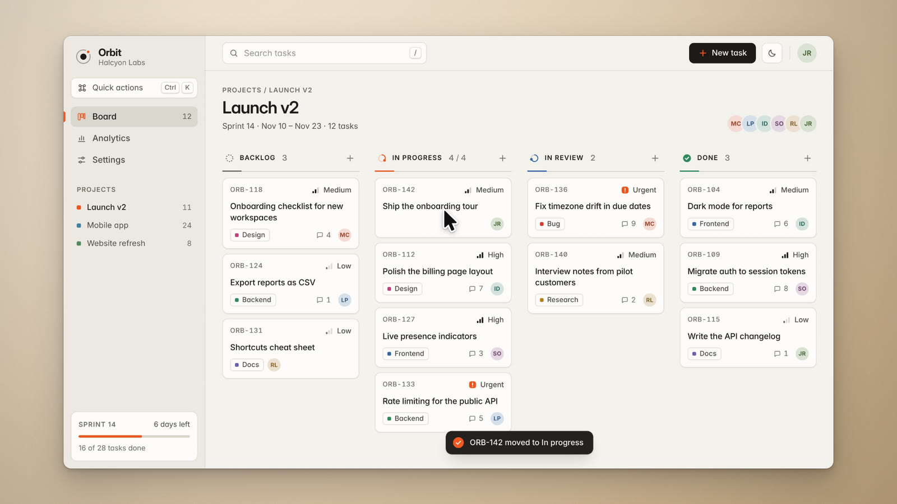
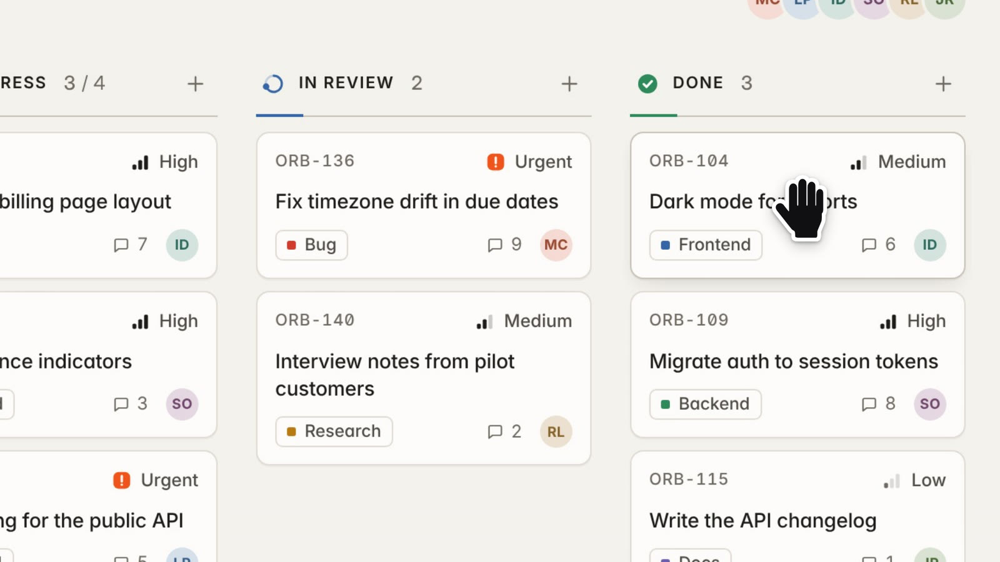
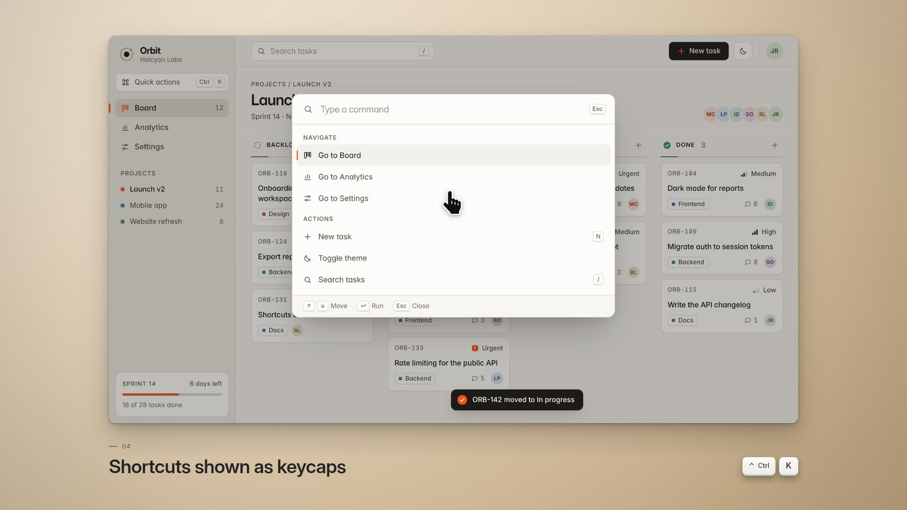

# autocast

Automated, polished screencasts of web apps. Built for agents.

<!-- Demo video: upload the README demo to GitHub and put its link on the next line. -->



You write a short script that says what happens on the page and where the camera looks.
`autocast` records the page with Playwright and renders the video: a smooth cursor, click
effects, zooms that follow the action, and a framed window. There is no editor.

It works with anything that opens in a browser.

## Install

```sh
npm install --save-dev @jtpio/autocast playwright
npx playwright install chromium
```

You also need Node.js 22.18 or later and `ffmpeg` on the `PATH`.

## Use it with an agent

Give the skill to your agent:

```sh
npx skills add jtpio/autocast
```

Then ask for the video:

> Record a screencast of http://localhost:3000 that shows how to create a project.

The agent explores the app, writes the script, records it, checks the result on still images
and renders the video.

## Write a script

```ts
import { defineScreencast } from '@jtpio/autocast';

export default defineScreencast({
  name: 'new-task',
  url: 'http://localhost:4173',

  async run(cast) {
    const { page } = cast;
    await cast.click(page.getByRole('button', { name: 'New task' }));
    await cast.zoomTo(page.getByRole('dialog'), { level: 'medium' });
    await cast.type('Ship the onboarding tour', { into: page.getByLabel('Title') });
    await cast.click(page.getByRole('button', { name: 'Create task' }));
    await cast.zoomOut();
  },
});
```

```sh
npx autocast record new-task.ts -o new-task.mp4
```

A target is a Playwright locator, a selector, a point or a rectangle.

| Call                                           | Effect                                           |
| ---------------------------------------------- | ------------------------------------------------ |
| `click`, `dblclick`, `rightClick`, `hover`     | Moves the cursor along a natural path, then acts |
| `drag(from, to)`, `scroll`, `scrollTo`         | Drag and smooth scroll                           |
| `type(text)`, `press('Shift+Enter')`           | Human typing and shortcuts                       |
| `zoomTo(target)`, `zoom('close')`, `zoomOut()` | Camera moves                                     |
| `wait(ms)`, `cut(fn)`, `speed(rate, fn)`       | Hold a shot, remove a wait, play a part faster   |
| `caption(text)`, `spotlight(target)`           | Optional overlays                                |

Use `cast` for every action that the viewer must see. `cast.page` is the Playwright page, for
waits and for reading state.

## Features

| Camera                                                                           | Overlays                                                              |
| -------------------------------------------------------------------------------- | --------------------------------------------------------------------- |
|                                 |  |
| Named zoom levels, a fit to an element, and a camera that can follow the cursor. | Captions on the backdrop and shortcuts as keycaps. Both are optional. |

- **Cursor.** A large vector cursor that takes the shape the page asks for, with click
  effects, motion blur, and a slight tilt when it travels.
- **Camera.** `zoomTo` frames an element; `zoom` zooms on the cursor. Each shot has a follow
  mode: `off`, `edge` or `cursor`.
- **Look.** Ten backdrops, padding, rounded corners, shadow, and an optional title bar.
- **Output.** Any size and frame rate, as mp4, webm or gif.
- **Frame-perfect capture.** `--set capture.mode=frame-perfect` controls the page clock, so
  page motion is exact at 60 fps on any machine. Use it for the final recording.
- **Made for agents.** `autocast inspect` prints the timeline and writes a contact sheet, so an
  agent can check a video that it cannot watch.


## Commands

```sh
autocast record <script>           # record, then render
autocast render <session>          # render a recording again, with other options
autocast frame <session> --at 12   # one still frame
autocast inspect <session|video>   # timeline and contact sheet
```

A recording is stored as a session in `.autocast/<name>`. The look is decided at render time,
so one recording can give many videos:

```sh
autocast render .autocast/new-task -o tall.mp4 --size 1080x1920 --background ink
autocast render .autocast/new-task -o big.mp4 --size 3840x2160 --set encode.quality=high
autocast render .autocast/new-task -o plain.mp4 --set cursor.tilt=0 --set zoom.follow=off
```

`--set key=value` sets any option. Run `autocast --help` for the other flags.

## Options

Options are fields of the script, and render options go under `render`.

```ts
export default defineScreencast({
  viewport: { width: 1280, height: 720 },
  capture: { mode: 'realtime' }, // or 'frame-perfect'
  typing: { delay: 45 },

  render: {
    size: { width: 1920, height: 1080 },
    fps: 60,
    background: 'dusk', // paper, fog, sage, dune, clay, dusk, harbor, graphite, ink, ember
    frame: { padding: 0.07, radius: 16, chrome: 'none' },
    cursor: { size: 1.9, motionBlur: 0.5, tilt: 1 },
    zoom: { follow: 'edge', levels: { wide: 1.3, medium: 1.6, close: 2.2 } },
    encode: { quality: 'standard' }, // draft, standard, high, max
  },

  async run(cast) {},
});
```

Every option, with its meaning, is in [`src/types.ts`](src/types.ts). The skill in
[`skills/autocast`](skills/autocast/SKILL.md) has the full workflow and the direction rules.

## Examples

The [`examples`](examples) directory has scripts for JupyterLab, JupyterLite and a demo app.
Each script names the command that starts its server.

## Development

```sh
npm install
npm test
node src/cli.ts record examples/orbit-board.ts   # runs from source
```

See [RELEASE.md](RELEASE.md) for the release steps.

## License

BSD 3-Clause. See [LICENSE](LICENSE).
