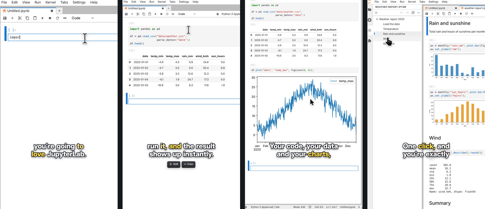

# autokast

Automated, polished screencasts of web apps. Built for agents.

<!-- Demo video: upload the README demo to GitHub and put its link on the next line. -->

https://github.com/user-attachments/assets/086be325-b794-4391-9ec5-87e619862c43

You write a short script that says what happens on the page and where the camera looks.
`autokast` records the page with Playwright and renders the video: a smooth cursor, click
effects, zooms that follow the action, and a framed window. There is no editor.

It works with anything that opens in a browser.

## Install

```sh
npm install --save-dev autokast playwright
npx playwright install chromium
```

You also need Node.js 22.18 or later and `ffmpeg` on the `PATH`.

## Use it with an agent

Give the skill to your agent:

```sh
npx skills add jtpio/autokast
```

Then ask for the video:

> Record a screencast of http://localhost:3000 that shows how to create a project.

The agent explores the app, writes the script, records it, checks the result on still images
and renders the video.

## Write a script

```ts
import { defineScreencast } from 'autokast';

export default defineScreencast({
  name: 'new-task',
  url: 'http://localhost:4173',

  async run(cast) {
    const { page } = cast;
    await cast.click(page.getByRole('button', { name: 'New task' }));
    await cast.zoomTo(page.getByRole('dialog'), { level: 'medium' });
    await cast.type('Ship the onboarding tour', { into: page.getByLabel('Title') });
    await cast.click(page.getByRole('button', { name: 'Create task' }));
    await cast.zoomOut();
  },
});
```

```sh
npx autokast record new-task.ts -o new-task.mp4
```

A target is a Playwright locator, a selector, a point or a rectangle.

| Call                                           | Effect                                           |
| ---------------------------------------------- | ------------------------------------------------ |
| `click`, `dblclick`, `rightClick`, `hover`     | Moves the cursor along a natural path, then acts |
| `drag(from, to)`, `scroll`, `scrollTo`         | Drag and smooth scroll                           |
| `select(target, values)`                       | Chooses options of a native `<select>`           |
| `type(text)`, `press('Shift+Enter')`           | Human typing and shortcuts                       |
| `goto(url)`, `showUrl()`                       | Opens a URL; shows the URL in the browser frame  |
| `zoomTo(target)`, `zoom('close')`, `zoomOut()` | Camera moves                                     |
| `wait(ms)`, `cut(fn)`, `speed(rate, fn)`       | Hold a shot, remove a wait, play a part faster   |
| `caption(text)`                                | A caption on the backdrop, or animated subtitles |
| `spotlight(target)`                            | Dims the page around one element                 |

Use `cast` for every action that the viewer must see. `cast.page` is the Playwright page, for
waits and for reading state.

## Features

| Camera                                                                           | Overlays                                                              |
| -------------------------------------------------------------------------------- | --------------------------------------------------------------------- |
|                                 |  |
| Named zoom levels, a fit to an element, and a camera that can follow the cursor. | Captions on the backdrop and shortcuts as keycaps. Both are optional. |

- **Cursor.** A large vector cursor that takes the shape the page asks for, with click
  effects, motion blur, and a slight tilt when it travels.
- **Camera.** `zoomTo` frames an element; `zoom` zooms on the cursor. Zoom levels have names
  (`wide`, `medium`, `close`), and a script can add its own. Each shot has a follow mode:
  `off`, `edge` or `cursor`. The render warns when a zoom goes deeper than the capture scale
  allows.
- **Spotlight.** `spotlight` dims the page around one element for a moment.
- **Look.** Ten backdrops, or your own color, gradient or image. Padding, rounded corners,
  shadow, and an optional title bar or browser frame with an address bar that follows the
  page URL.
- **Output.** Any size and frame rate, as mp4, webm or gif.
- **Vertical videos.** `--vertical` records and renders for a phone screen, and captions can
  show as animated subtitles.
- **Voice.** `--voice` adds a voice that says the captions, in sync with the subtitles.
- **Frame-perfect capture.** `--set capture.mode=frame-perfect` controls the page clock, so
  page motion is exact at 60 fps on any machine. Use it for the final recording.
- **Made for agents.** `autokast inspect` prints the timeline and writes a contact sheet, so an
  agent can check a video that it cannot watch.


## Commands

```sh
autokast record <script>           # record, then render
autokast render <session>          # render a recording again, with other options
autokast frame <session> --at 12   # one still frame
autokast inspect <session|video>   # timeline and contact sheet
```

A recording is stored as a session in `.autokast/<name>`. The look is decided at render time,
so one recording can give many videos:

```sh
autokast render .autokast/new-task -o tall.mp4 --vertical --background ink
autokast render .autokast/new-task -o big.mp4 --size 3840x2160 --set encode.quality=high
autokast render .autokast/new-task -o photo.mp4 --background wallpaper.jpg --padding 0.12
autokast render .autokast/new-task -o plain.mp4 --set cursor.tilt=0 --set zoom.follow=off
```

`--set key=value` sets any option. Run `autokast --help` for the other flags.

## Presets

A preset sets several render options at once, so that a common look takes one flag:

| Preset     | Look                                                                                    |
| ---------- | --------------------------------------------------------------------------------------- |
| `plain`    | The page fills the video: no backdrop, no zoom, no caption, no keycap. Spotlights stay. |
| `focus`    | `plain` with the zooms of the script.                                                   |
| `showcase` | A backdrop, the browser frame, zooms, captions, spotlights and shortcut keycaps.        |

```sh
autokast render .autokast/new-task -o plain.mp4 --preset plain
```

In a script, set `render: { preset: 'focus' }`. The other options at the same level override
the preset, and a preset given to `render` replaces the look of the script. To turn off one
effect without a preset, set `zoom.enabled`, `captions.enabled` or `spotlight.enabled` to
`false`.

## Vertical videos and subtitles



`vertical` makes a video for a phone screen: 1080x1920 by default.

```sh
autokast record new-task.ts --vertical -o new-task.mp4      # records the page at 720x1280
autokast render .autokast/new-task --vertical -o tall.mp4   # a recording that exists
```

In a script, `vertical: true` turns the viewport so that its long side is vertical (1280x720
becomes 720x1280), and the output size does the same. The page then has the layout of a
narrow window and fills the video. `render: { vertical: true }` turns only the output size:
a wide window is small in a tall video, so its text is readable only in the zoomed shots.

Captions can show as subtitles, as on short videos: large words over the video. A sentence
shows at once, then a highlight color goes from word to word at the pace of speech. Words
between `**` have the color all the time. The color is yellow by default:
`captions.highlight` sets it for the video, and the `highlight` option of `cast.caption`
sets it for one caption.

```ts
export default defineScreencast({
  vertical: true,
  render: {
    captions: { style: 'subtitles', highlight: '#5fe08a' },
    keystrokes: { show: 'shortcuts', size: 1.5 },
  },

  async run(cast) {
    await cast.caption('Write code in a **notebook**');
    await cast.caption('Then make a chart', { highlight: '#5cc8ff' });
  },
});
```

The two options do not depend on each other: `--set captions.style=subtitles` also gives
subtitles in a wide video. A zoomed shot puts its target above the subtitles, and the
keycaps are below them. [`examples/jupyterlab-vertical.ts`](examples/jupyterlab-vertical.ts)
is a full script.

## Voice

`--voice` adds a voice that says the captions of the script. The voice comes from the
[ElevenLabs](https://elevenlabs.io) API, which needs a key in the `ELEVENLABS_API_KEY`
environment variable.

```sh
export ELEVENLABS_API_KEY=...
autokast render .autokast/new-task --voice -o new-task.mp4
```

With the `subtitles` caption style, the highlight follows the voice: each word has the color
while it is said. In a script, set `render: { voice: { enabled: true } }`. The fields
`voiceId`, `model` and `speed` select the voice. The default voice is Liam, one of the
default voices of ElevenLabs. ElevenLabs can remove its default voices: set `voiceId` to a
voice of your account when that occurs.

Each speech clip is made one time and kept in the session directory (`.autokast/<name>/voice`),
so the next render of the same captions does not call the API. A voice does not start before
the voice of the caption before it ends, and the render prints a warning when a caption has
too little time for its voice. A GIF has no sound.

## Options

Options are fields of the script, and render options go under `render`.

```ts
export default defineScreencast({
  viewport: { width: 1280, height: 720 },
  deviceScaleFactor: 3, // default: 2; 3 keeps text sharp in deep zooms
  capture: { mode: 'realtime' }, // or 'frame-perfect'
  typing: { delay: 45 },

  render: {
    size: { width: 1920, height: 1080 },
    fps: 60,
    // paper, fog, sage, dune, clay, dusk, harbor, graphite, ink, ember, a CSS color or an image
    background: 'dusk',
    frame: { padding: 0.07, radius: 16, chrome: 'none' }, // none, window, browser
    cursor: { size: 1.9, motionBlur: 0.5, tilt: 1 },
    zoom: { follow: 'edge', levels: { wide: 1.3, medium: 1.6, close: 2.2 } },
    encode: { quality: 'standard' }, // draft, standard, high, max
  },

  async run(cast) {},
});
```

`background` is a preset name, a CSS color, the path of an image file, or an object:
`{ type: 'image', path: 'wallpaper.jpg', blur: 12 }` or
`{ type: 'gradient', colors: ['#1e3a5f', '#c98b6b'], angle: 135 }`. `frame.padding` is the space
between the window and the edges of the video: a fraction of the short side when below 1,
pixels otherwise. With 0 there is no background: the window fills the video, with square
corners, when the viewport and the output have the same aspect ratio. Captions and keycaps are
then over the page. `zoom.levels` takes any names, for example `{ hero: 2.8 }`, and
`cast.zoom('hero')` then uses that level.

Every option, with its meaning, is in [`src/types.ts`](src/types.ts). The skill in
[`skills/autokast`](skills/autokast/SKILL.md) has the full workflow and the direction rules.

## Examples

The [`examples`](examples) directory has scripts for JupyterLab, JupyterLite and a demo app.
Each script names the command that starts its server. The video at the top of this page is
[`examples/jupyterlab-demo.ts`](examples/jupyterlab-demo.ts), and
[`examples/jupyterlab-vertical.ts`](examples/jupyterlab-vertical.ts) is its vertical version.

## Development

```sh
npm install
npm test
node src/cli.ts record examples/orbit-board.ts   # runs from source
```

See [RELEASE.md](RELEASE.md) for the release steps.

## License

BSD 3-Clause. See [LICENSE](LICENSE).
