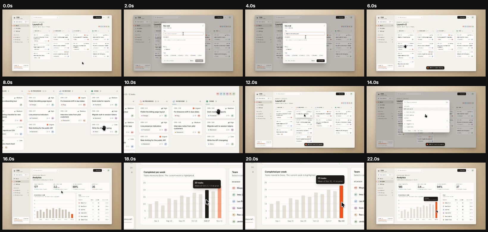
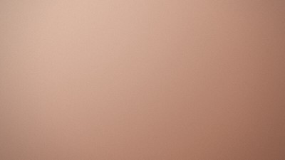
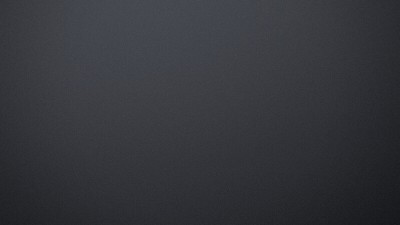
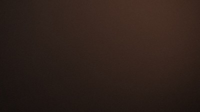

# autokast

Automated, polished screencasts of web apps. Built for agents.

<!-- Demo video: upload the README demo to GitHub and put its link on the next line. -->

https://github.com/user-attachments/assets/086be325-b794-4391-9ec5-87e619862c43

You write a short script that says what happens on the page and where the camera looks.
`autokast` records the page with Playwright and renders the video: a smooth cursor, click
effects, zooms that follow the action, and a framed window. There is no editor.

It works with anything that opens in a browser.

## Install

```sh
npm install --save-dev autokast playwright
npx playwright install chromium
```

You also need Node.js 22.18 or later and `ffmpeg` on the `PATH`.

## Use it with an agent

Give the skill to your agent:

```sh
npx skills add jtpio/autokast
```

Then ask for the video:

> Record a screencast of http://localhost:3000 that shows how to create a project.

The agent explores the app, writes the script, records it, checks the result on still images
and renders the video.

## Write a script

```ts
import { defineScreencast } from 'autokast';

export default defineScreencast({
  name: 'new-task',
  url: 'http://localhost:4173',

  async run(cast) {
    const { page } = cast;
    await cast.click(page.getByRole('button', { name: 'New task' }));
    await cast.zoomTo(page.getByRole('dialog'), { level: 'medium' });
    await cast.type('Ship the onboarding tour', { into: page.getByLabel('Title') });
    await cast.click(page.getByRole('button', { name: 'Create task' }));
    await cast.zoomOut();
  },
});
```

```sh
npx autokast record new-task.ts -o new-task.mp4
```

A target is a Playwright locator, a selector, a point or a rectangle.

| Call                                           | Effect                                           |
| ---------------------------------------------- | ------------------------------------------------ |
| `click`, `dblclick`, `rightClick`, `hover`     | Moves the cursor along a natural path, then acts |
| `moveTo(target)`                               | Moves the cursor only                            |
| `drag(from, to)`, `scroll`, `scrollTo`         | Drag and smooth scroll                           |
| `select(target, values)`                       | Chooses options of a native `<select>`           |
| `type(text)`, `press('Shift+Enter')`           | Human typing and shortcuts                       |
| `goto(url)`, `showUrl()`                       | Opens a URL; shows the URL in the browser frame  |
| `zoomTo(target)`, `zoom('close')`, `zoomOut()` | Camera moves                                     |
| `wait(ms)`, `cut(fn)`, `speed(rate, fn)`       | Hold a shot, remove a wait, play a part faster   |
| `caption(text)`                                | A caption on the backdrop, or animated subtitles |
| `spotlight(target)`                            | Dims the page around one element                 |
| `marker(label)`                                | Names a point in time, which `inspect` shows     |

Use `cast` for every action that the viewer must see. `cast.page` is the Playwright page, for
waits and for reading state. Most calls take options: see [Call options](#call-options).

A script can also have a `setup({ page })` function. It runs after the page opens and before
the recording starts: use it to log in, to prepare data or to wait for the app.

## Features

| Camera                                                                           | Overlays                                                              |
| -------------------------------------------------------------------------------- | --------------------------------------------------------------------- |
|                                 |  |
| Named zoom levels, a fit to an element, and a camera that can follow the cursor. | Captions on the backdrop and shortcuts as keycaps. Both are optional. |

- **Cursor.** A large vector cursor that takes the shape the page asks for, with click
  effects, motion blur, and a slight tilt when it travels. With `cursor.hideAfter`, it fades
  out while it does not move, and fades in again before its next move.
- **Camera.** `zoomTo` frames an element; `zoom` zooms on the cursor. Zoom levels have names
  (`wide`, `medium`, `close`), and a script can add its own. Each shot has a follow mode:
  `off`, `edge` or `cursor`. The render warns when a zoom goes deeper than the capture scale
  allows.
- **Spotlight.** `spotlight` dims the page around one element for a moment.
- **Look.** [Ten backdrops](#render-options), or your own color, gradient or image. Padding,
  rounded corners, shadow, and an optional title bar or browser frame with an address bar that
  follows the page URL.
- **Output.** Any size and frame rate, as mp4, webm or gif.
- **Vertical videos.** `--vertical` records and renders for a phone screen, and captions can
  show as animated subtitles.
- **Voice.** `--voice` adds a voice that says the captions, in sync with the subtitles.
- **Frame-perfect capture.** `--set capture.mode=frame-perfect` controls the page clock, so
  page motion is exact at 60 fps on any machine. Use it for the final recording.
- **Made for agents.** `autokast inspect` prints the timeline and writes a contact sheet, so an
  agent can check a video that it cannot watch.



## Commands

```sh
autokast record <script>           # record, then render
autokast render <session>          # render a recording again, with other options
autokast frame <session> --at 12   # one still frame
autokast inspect <session|video>   # timeline and contact sheet
```

A recording is stored as a session in `.autokast/<name>`. The look is decided at render time,
so one recording can give many videos:

```sh
autokast render .autokast/new-task -o tall.mp4 --vertical --background ink
autokast render .autokast/new-task -o big.mp4 --size 3840x2160 --set encode.quality=high
autokast render .autokast/new-task -o photo.mp4 --background wallpaper.jpg --padding 0.12
autokast render .autokast/new-task -o plain.mp4 --set cursor.tilt=0 --set zoom.follow=off
autokast render .autokast/new-task -o calm.mp4 --set cursor.hideAfter=1000
```

### Flags

These flags set render options. All commands accept them, but `--preview` is only for `record`
and `render`.

| Flag                | Effect                                                                                    |
| ------------------- | ----------------------------------------------------------------------------------------- |
| `-o, --out <file>`  | Output file: `.mp4`, `.webm` or `.gif` for a video, `.png` for `frame` and `inspect`      |
| `--preset <name>`   | `plain`, `focus` or `showcase`: see [Presets](#presets)                                   |
| `--size <WxH>`      | Output size, for example `1920x1080`                                                      |
| `--vertical`        | Vertical video: 1080x1920 by default. With `record`, the viewport also turns (720x1280)   |
| `--fps <n>`         | Output frame rate                                                                         |
| `--background <b>`  | A backdrop name, an image file or a CSS color                                             |
| `--padding <n>`     | Space around the window: a fraction of the short side when below 1, pixels otherwise      |
| `--voice`           | A voice says the captions (needs `ELEVENLABS_API_KEY`)                                    |
| `--range <a:b>`     | Renders only this part of the video, in seconds. One side can be empty: `5:` or `:10`     |
| `--preview`         | Fast render: half the size, 30 fps, `draft` quality                                       |
| `--set <key=value>` | Sets one option by its path. You can repeat it                                            |
| `--config <file>`   | A JSON file with render options, for example `{ "preset": "focus", "background": "ink" }` |

Each command also has its own flags:

| Command   | Flag                | Effect                                                              |
| --------- | ------------------- | ------------------------------------------------------------------- |
| `record`  | `--session <dir>`   | Session directory. Default: `.autokast/<name>`                      |
| `record`  | `--no-render`       | Records only                                                        |
| `record`  | `--headed`          | Shows the browser window                                            |
| `frame`   | `--at <sec>`        | Time of the still frame in the video                                |
| `inspect` | `--every <sec>`     | Time between two tiles. Default: a step that gives at most 16 tiles |
| `inspect` | `--from <sec>`      | Start time                                                          |
| `inspect` | `--to <sec>`        | End time                                                            |
| `inspect` | `--cols <n>`        | Columns. Default: 4, or 8 for a vertical video                      |
| `inspect` | `--tile-width <px>` | Width of one tile. Default: 480, or 270 for a vertical video        |

`--set` takes the path of an option from [Options](#options). The value is read as JSON when
that is possible, and as a string otherwise:

```sh
autokast render .autokast/new-task --set zoom.follow=off --set frame.shadow=false
autokast render .autokast/new-task --set 'zoom.levels={"hero":2.8}'
```

For `render`, `frame` and `inspect`, the path is a render option. For `record`, the path is a
field of the script, so a render option needs the `render.` prefix:

```sh
autokast record new-task.ts --set capture.mode=frame-perfect --set render.background=ink
```

When two sources set the same option, the last one in this list applies:

1. The defaults.
2. The `render` field of the script. `record --set render.<option>` changes this field.
3. `--config`.
4. `--set` of `render`, `frame` and `inspect`.
5. The other flags.

## Presets

A preset sets several render options at once, so that a common look takes one flag:

| Preset     | Look                                                                                    |
| ---------- | --------------------------------------------------------------------------------------- |
| `plain`    | The page fills the video: no backdrop, no zoom, no caption, no keycap. Spotlights stay. |
| `focus`    | `plain` with the zooms of the script.                                                   |
| `showcase` | A backdrop, the browser frame, zooms, captions, spotlights and shortcut keycaps.        |

```sh
autokast render .autokast/new-task -o plain.mp4 --preset plain
```

In a script, set `render: { preset: 'focus' }`. The other options at the same level override
the preset, and a preset given to `render` replaces the look of the script. To turn off one
effect without a preset, set `zoom.enabled`, `captions.enabled` or `spotlight.enabled` to
`false`.

## Vertical videos and subtitles


`vertical` makes a video for a phone screen: 1080x1920 by default.

```sh
autokast record new-task.ts --vertical -o new-task.mp4      # records the page at 720x1280
autokast render .autokast/new-task --vertical -o tall.mp4   # a recording that exists
```

In a script, `vertical: true` turns the viewport so that its long side is vertical (1280x720
becomes 720x1280), and the output size does the same. The page then has the layout of a
narrow window and fills the video. `render: { vertical: true }` turns only the output size:
a wide window is small in a tall video, so its text is readable only in the zoomed shots.

Captions can show as subtitles, as on short videos: large words over the video. A sentence
shows at once, then a highlight color goes from word to word at the pace of speech. Words
between `**` have the color all the time. The color is yellow by default:
`captions.highlight` sets it for the video, and the `highlight` option of `cast.caption`
sets it for one caption.

```ts
export default defineScreencast({
  vertical: true,
  render: {
    captions: { style: 'subtitles', highlight: '#5fe08a' },
    keystrokes: { show: 'shortcuts', size: 1.5 },
  },

  async run(cast) {
    await cast.caption('Write code in a **notebook**');
    await cast.caption('Then make a chart', { highlight: '#5cc8ff' });
  },
});
```

The two options do not depend on each other: `--set captions.style=subtitles` also gives
subtitles in a wide video. A zoomed shot puts its target above the subtitles, and the
keycaps are below them. [`examples/jupyterlab-vertical.ts`](examples/jupyterlab-vertical.ts)
is a full script.

## Voice

`--voice` adds a voice that says the captions of the script. The voice comes from the
[ElevenLabs](https://elevenlabs.io) API, which needs a key in the `ELEVENLABS_API_KEY`
environment variable.

```sh
export ELEVENLABS_API_KEY=...
autokast render .autokast/new-task --voice -o new-task.mp4
```

With the `subtitles` caption style, the highlight follows the voice: each word has the color
while it is said. In a script, set `render: { voice: { enabled: true } }`. The fields
`voiceId`, `model` and `speed` select the voice. The default voice is Liam, one of the
default voices of ElevenLabs. ElevenLabs can remove its default voices: set `voiceId` to a
voice of your account when that occurs.

Each speech clip is made one time and kept in the session directory (`.autokast/<name>/voice`),
so the next render of the same captions does not call the API. A voice does not start before
the voice of the caption before it ends, and the render prints a warning when a caption has
too little time for its voice. A GIF has no sound.

## Options

Options are fields of the script. The fields at the top level control the recording. The
fields under `render` control the look of the video, and a later render can change them
without a new recording.

```ts
export default defineScreencast({
  viewport: { width: 1280, height: 720 },
  deviceScaleFactor: 3, // default: 2; 3 keeps text sharp in deep zooms
  capture: { mode: 'realtime' }, // or 'frame-perfect'
  typing: { delay: 45 },

  render: {
    size: { width: 1920, height: 1080 },
    fps: 60,
    // paper, fog, sage, dune, clay, dusk, harbor, graphite, ink, ember, a CSS color or an image
    background: 'dusk',
    frame: { padding: 0.07, radius: 16, chrome: 'none' }, // none, window, browser
    cursor: { size: 1.9, motionBlur: 0.5, tilt: 1 },
    zoom: { follow: 'edge', levels: { wide: 1.3, medium: 1.6, close: 2.2 } },
    encode: { quality: 'standard' }, // draft, standard, high, max
  },

  async setup({ page }) {},
  async run(cast) {},
});
```

In the tables below, times are in milliseconds. The pixel values of the look, such as a
padding, a radius or a font size, are for an output with a short side of 1080 pixels. They
scale with the output size.

### Recording options

These options are at the top level of the script. A change needs a new recording.

| Option                                     | Default            | Meaning                                                                                                                                                                                                                                 |
| ------------------------------------------ | ------------------ | --------------------------------------------------------------------------------------------------------------------------------------------------------------------------------------------------------------------------------------- |
| `name`                                     | `screencast`       | Name of the screencast. It gives the session directory and the default output file.                                                                                                                                                     |
| `url`                                      | none               | Page that opens before `setup`.                                                                                                                                                                                                         |
| `viewport`                                 | 1280x720           | Size of the page, as `{ width, height }` in CSS pixels.                                                                                                                                                                                 |
| `vertical`                                 | `false`            | `true` turns the viewport and the output size so that the long side is vertical.                                                                                                                                                        |
| `deviceScaleFactor`                        | `2`                | Device pixels for each CSS pixel. Set 3 for sharp text in deep zooms: the render warns when a zoom needs it.                                                                                                                            |
| `colorScheme`                              | none               | `light` or `dark`: the color scheme that the page gets.                                                                                                                                                                                 |
| `sessionDir`                               | `.autokast/<name>` | Directory of the session.                                                                                                                                                                                                               |
| `browser`                                  | `{}`               | Playwright launch options, such as `executablePath`, `channel` or `args`. `browser.contextOptions` has the options of the browser context.                                                                                              |
| `capture.mode`                             | `realtime`         | `realtime` captures the page as it paints. `frame-perfect` controls the page clock: the recording takes longer, but page motion is exact on any machine. It needs the default headless browser: no `--headed` and no `browser.channel`. |
| `capture.fps`                              | `60`               | Frames per second of page time in `frame-perfect` mode.                                                                                                                                                                                 |
| `capture.clockLead`                        | `600000`           | `frame-perfect` mode: how far the page clock starts ahead of the real clock. Without a lead, a time stamp from a server can be in the future of the page.                                                                               |
| `capture.format`, `capture.quality`        | `jpeg`, `92`       | Format of the captured frames (`jpeg` or `png`), and the JPEG quality from 0 to 100.                                                                                                                                                    |
| `cursor.start`                             | center             | Start position of the cursor, as `{ x, y }` in the viewport.                                                                                                                                                                            |
| `cursor.speed`                             | `1`                | Speed multiplier of the cursor moves. 2 is twice as fast.                                                                                                                                                                               |
| `cursor.curvature`                         | `0.2`              | Curvature of the cursor path, from 0 (straight) to 1.                                                                                                                                                                                   |
| `cursor.minDuration`, `cursor.maxDuration` | `220`, `1000`      | Limits for the duration of one cursor move.                                                                                                                                                                                             |
| `typing.delay`                             | `45`               | Mean delay between two characters. The default gives about 16 characters each second.                                                                                                                                                   |
| `typing.variance`                          | `0.35`             | Random variation of the delay, from 0 to 1.                                                                                                                                                                                             |
| `pacing.startDelay`, `pacing.endDelay`     | `400`, `900`       | Pause before the first call and after the last one.                                                                                                                                                                                     |
| `pacing.beforeClick`, `pacing.afterClick`  | `60`, `180`        | Pause between the end of the cursor move and the press, and pause after the click.                                                                                                                                                      |
| `pacing.afterType`                         | `120`              | Pause after `type` and `press`.                                                                                                                                                                                                         |
| `pacing.pressDuration`                     | `90`               | Time that the mouse button stays down for a click.                                                                                                                                                                                      |
| `scrollBehavior`                           | `smooth`           | How a target that is off screen comes into view before an action: `smooth` or `instant`.                                                                                                                                                |
| `timeout`                                  | `10000`            | Time limit for one call.                                                                                                                                                                                                                |
| `seed`                                     | from `name`        | Seed for the random variations of the cursor path and the typing rhythm. The same seed gives the same motion.                                                                                                                           |
| `render`                                   | none               | The [render options](#render-options) of the script. The session keeps them as its defaults.                                                                                                                                            |
| `setup`, `run`                             | none               | `setup({ page })` runs before the recording starts. `run(cast)` is the recording.                                                                                                                                                       |

The `cursor` option at the top level controls how the cursor moves. `render.cursor` controls
how the cursor looks.

### Render options

These options are under `render` in the script. A flag, `--set` or `--config` can change them
for one render.

| Option       | Default      | Meaning                                                                                                 |
| ------------ | ------------ | ------------------------------------------------------------------------------------------------------- |
| `preset`     | none         | `plain`, `focus` or `showcase`: see [Presets](#presets).                                                |
| `output`     | `<name>.mp4` | Output file. The extension selects the format: `.mp4`, `.webm` or `.gif`.                               |
| `size`       | 1920x1080    | Output size, as `{ width, height }`.                                                                    |
| `vertical`   | `false`      | `true` turns the size so that its long side is vertical.                                                |
| `fps`        | `60`         | Frame rate, from 1 to 240. A GIF has 25 frames each second at most, and a width of 1280 pixels at most. |
| `background` | `dusk`       | What shows behind the window: see below.                                                                |
| `range`      | full video   | `{ start, end }`: renders only this part of the video.                                                  |

`background` is a backdrop name, a CSS color, the path of an image file, or an object:
`{ type: 'image', path: 'wallpaper.jpg', blur: 12 }` or
`{ type: 'gradient', colors: ['#1e3a5f', '#c98b6b'], angle: 135 }`. The backdrops, from light
to dark:

| `paper`                                                                         | `fog`                                                                      | `sage`                                                                         | `dune`                                                                  | `clay`                                                                        |
| ------------------------------------------------------------------------------- | -------------------------------------------------------------------------- | ------------------------------------------------------------------------------ | ----------------------------------------------------------------------- | ----------------------------------------------------------------------------- |
|  |  |  |  |  |

| `dusk`                                                                                           | `harbor`                                                                         | `graphite`                                                                           | `ink`                                                                       | `ember`                                                                         |
| ------------------------------------------------------------------------------------------------ | -------------------------------------------------------------------------------- | ------------------------------------------------------------------------------------ | --------------------------------------------------------------------------- | ------------------------------------------------------------------------------- |
|  |  |  |  |  |

To see a backdrop behind your app, render one frame:
`autokast frame .autokast/new-task --at 1 --background harbor`.

#### Frame

| Option              | Default            | Meaning                                                                                                                                           |
| ------------------- | ------------------ | ------------------------------------------------------------------------------------------------------------------------------------------------- |
| `frame.padding`     | `0.07`             | Space between the window and the edges of the video: a fraction of the short side when below 1, pixels otherwise.                                 |
| `frame.radius`      | `16`               | Corner radius of the window.                                                                                                                      |
| `frame.shadow`      | a soft dark shadow | `{ color, blur, offsetY }`, or `false` for no shadow. The defaults are `rgba(8, 10, 18, 0.6)`, `72` and `30`.                                     |
| `frame.chrome`      | `none`             | `window` adds a title bar. `browser` adds a browser toolbar with an address bar that follows the URL of the page.                                 |
| `frame.title`       | none               | Text of the title bar, for the `window` chrome.                                                                                                   |
| `frame.chromeTheme` | `light`            | `light` or `dark`, for the title bar and the browser toolbar.                                                                                     |
| `frame.address`     | `true`             | Text of the address bar. `true` shows the URL of the page, a string shows that text for the full video, and `false` leaves the address bar empty. |
| `frame.origin`      | none               | Replaces the origin of the page URL in the address bar, for example `example.org/demo` for a site that was recorded on `localhost:8000`.          |

With `frame.padding: 0` there is no background: the window fills the video, with square
corners, when the viewport and the output have the same aspect ratio. Captions and keycaps are
then over the page.

#### Cursor

| Option                  | Default  | Meaning                                                                                                                   |
| ----------------------- | -------- | ------------------------------------------------------------------------------------------------------------------------- |
| `cursor.visible`        | `true`   | `false` hides the cursor.                                                                                                 |
| `cursor.size`           | `1.9`    | Size multiplier. 1 is the size of a system cursor.                                                                        |
| `cursor.smoothing`      | `0.3`    | Smoothing of the cursor position, from 0 (off) to 1.                                                                      |
| `cursor.pressScale`     | `0.82`   | Scale of the cursor while a button is down.                                                                               |
| `cursor.hideAfter`      | `0`      | The cursor fades out after this time without a move, and fades in again before its next move. 0 keeps the cursor visible. |
| `cursor.motionBlur`     | `0.5`    | Motion blur of the cursor in fast moves, from 0 (off) to 1.                                                               |
| `cursor.tilt`           | `1`      | How much the cursor leans into its travel. 0 turns it off.                                                                |
| `cursor.click.type`     | `ripple` | Click effect: `ripple`, `ring` or `none`.                                                                                 |
| `cursor.click.color`    | `auto`   | A CSS color. `auto` selects white or a dark tone, whichever has more contrast with the page below the click.              |
| `cursor.click.size`     | `26`     | Final radius of the click effect.                                                                                         |
| `cursor.click.duration` | `520`    | Duration of the click effect.                                                                                             |

#### Zoom

| Option             | Default  | Meaning                                                                                                                                               |
| ------------------ | -------- | ----------------------------------------------------------------------------------------------------------------------------------------------------- |
| `zoom.enabled`     | `true`   | `false` ignores the zooms of the script: the camera stays on the full view.                                                                           |
| `zoom.levels`      | see text | Scale of each named level. The defaults are `wide` 1.3, `medium` 1.6 and `close` 2.2.                                                                 |
| `zoom.follow`      | `edge`   | How the camera reacts to the cursor in a zoomed shot that does not set it: `off`, `edge` (pans when the cursor comes near the edge) or `cursor`.      |
| `zoom.followSpeed` | `1`      | How fast the camera catches up with the cursor. 2 is twice as fast.                                                                                   |
| `zoom.duration`    | `900`    | Duration of a camera move that does not set it.                                                                                                       |
| `zoom.easing`      | `smooth` | `linear`, `easeInOutCubic`, `easeInOutQuart`, `easeInOutQuint`, `easeOutCubic`, `easeOutQuart`, `easeOutExpo` or `smooth`.                            |
| `zoom.maxScale`    | `3`      | Upper limit of the zoom scale.                                                                                                                        |
| `zoom.mode`        | `camera` | `camera` makes the window larger than the video. `crop` zooms inside a window that does not move.                                                     |
| `zoom.edges`       | `fill`   | `camera` mode, for a zoomed shot at an edge of the page: `fill` fills the video with the page, `keep` keeps the window edge and the backdrop in view. |
| `zoom.auto`        | `false`  | `true` adds zooms on clicks and typing when the script has no zoom. Also an object: `{ scale: 1.8, hold: 1500, mergeWindow: 2500 }`.                  |
| `zoom.motionBlur`  | `0`      | Motion blur of the camera moves, from 0 (off) to 1.                                                                                                   |

`zoom.levels` takes any names. With `levels: { hero: 2.8 }`, `cast.zoom('hero')` and
`cast.zoomTo(target, { level: 'hero' })` use that level, and the default levels stay.

#### Captions, keycaps and spotlights

| Option                | Default         | Meaning                                                                                                              |
| --------------------- | --------------- | -------------------------------------------------------------------------------------------------------------------- |
| `captions.enabled`    | `true`          | `false` hides the captions of the script.                                                                            |
| `captions.style`      | `line`          | `line` shows a caption as one line on the backdrop. `subtitles` shows it as large animated words over the video.     |
| `captions.position`   | `bottom`        | `bottom` or `top`.                                                                                                   |
| `captions.fontSize`   | `40` or `64`    | Font size. The default is 40 for `line` and 64 for `subtitles`.                                                      |
| `captions.fontFamily` | `Inter Display` | Font of the captions. The font must be installed on the machine.                                                     |
| `captions.highlight`  | `#ffd84a`       | Highlight color of the subtitles. The `highlight` option of `cast.caption` sets it for one caption.                  |
| `keystrokes.show`     | `none`          | `shortcuts` shows the key combinations of `cast.press` as keycaps.                                                   |
| `keystrokes.position` | `bottom`        | `bottom` or `top`.                                                                                                   |
| `keystrokes.size`     | `1`             | Size multiplier of the keycaps. A vertical video needs about 1.5.                                                    |
| `keystrokes.labels`   | by platform     | Key names on the caps: `mac` (⌘ Cmd, ⌥ Opt) or `pc` (Ctrl, Alt). The default is `mac` when the render runs on macOS. |
| `spotlight.enabled`   | `true`          | `false` ignores the spotlights of the script.                                                                        |

#### Voice

| Option          | Default                  | Meaning                                                          |
| --------------- | ------------------------ | ---------------------------------------------------------------- |
| `voice.enabled` | `false`                  | `true` adds a voice that says the captions: see [Voice](#voice). |
| `voice.voiceId` | `TX3LPaxmHKxFdv7VOQHJ`   | Id of the ElevenLabs voice. The default is Liam.                 |
| `voice.model`   | `eleven_multilingual_v2` | Id of the ElevenLabs model.                                      |
| `voice.speed`   | `1`                      | Speed of the speech. 1 is the speed of the voice.                |

#### Encoding

| Option               | Default        | Meaning                                                                                                             |
| -------------------- | -------------- | ------------------------------------------------------------------------------------------------------------------- |
| `encode.quality`     | `standard`     | `draft` (fast, for iteration), `standard`, `high` or `max` (visually lossless, large files).                        |
| `encode.crf`         | from `quality` | Constant rate factor of the encoder. A higher value gives a smaller file: `standard` is 16 for mp4 and 28 for webm. |
| `encode.preset`      | from `quality` | Speed preset of the x264 encoder, for mp4: for example `veryfast`, `medium` or `slow`.                              |
| `encode.pixelFormat` | `yuv420p`      | Pixel format of the video.                                                                                          |
| `encode.ffmpegPath`  | `ffmpeg`       | Path of the `ffmpeg` program. The `AUTOKAST_FFMPEG` environment variable does the same.                             |

### Call options

The last argument of a call is an object of options, for example
`cast.click(target, { position: { x: 0.9, y: 0.5 } })`. In this table:

- The click calls are `click`, `dblclick`, `rightClick` and `select`.
- The cursor calls are the click calls, `moveTo`, `hover` and `drag`.
- The camera calls are `zoomTo`, `zoom` and `zoomOut`.

| Calls                | Option               | Default              | Meaning                                                                                                                                                                              |
| -------------------- | -------------------- | -------------------- | ------------------------------------------------------------------------------------------------------------------------------------------------------------------------------------ |
| Cursor calls         | `position`           | near the center      | Position in the target, as fractions of its size: `{ x: 0.5, y: 0.5 }` is the middle. Values below 0 or above 1 are outside the target.                                              |
| Cursor calls         | `duration`           | from the distance    | Duration of the cursor move.                                                                                                                                                         |
| Cursor calls         | `timeout`            | `timeout` option     | Time limit of the call.                                                                                                                                                              |
| Click calls          | `button`             | `left`               | `left`, `right` or `middle`. `rightClick` always uses `right`.                                                                                                                       |
| Click calls          | `clickCount`         | `1`                  | Number of presses. `dblclick` always uses 2.                                                                                                                                         |
| Click calls          | `modifiers`          | none                 | Keys that are down for the click: `Alt`, `Control`, `Meta`, `Shift`.                                                                                                                 |
| Click calls          | `force`              | `false`              | `true` skips the actionability check of Playwright.                                                                                                                                  |
| Click calls          | `afterClick`         | `pacing.afterClick`  | Pause after the press. Use 0 before a `cut`, so that a loading state does not show.                                                                                                  |
| `hover`              | `hold`               | `450`                | Time that the cursor stays on the target.                                                                                                                                            |
| `drag`               | `toPosition`         | near the center      | Position in the destination. `position` is for the source.                                                                                                                           |
| `drag`               | `dragDuration`       | from the distance    | Duration of the move while the button is down.                                                                                                                                       |
| `type`               | `into`, `position`   | none                 | Target that the call clicks first, to focus it, and the position of that click.                                                                                                      |
| `type`               | `delay`, `variance`  | `typing` option      | Typing rhythm of this call.                                                                                                                                                          |
| `type`               | `indent`             | `auto`               | `auto` keeps the indentation of the text, also in editors that indent by themselves. `raw` sends the characters as they are.                                                         |
| `press`              | `hold`               | none                 | Time that the keys stay down.                                                                                                                                                        |
| `scroll`             | `at`                 | none                 | Target to which the cursor moves before the scroll.                                                                                                                                  |
| `scrollTo`           | `block`              | `center`             | Where the target ends in its scroll container: `start`, `center`, `end` or `nearest`.                                                                                                |
| `scroll`, `scrollTo` | `duration`           | from the distance    | Duration of the scroll.                                                                                                                                                              |
| `zoomTo`             | `level`, `scale`     | none                 | A named zoom level, or a scale. With neither, the camera fits the target plus `padding` in the video.                                                                                |
| `zoomTo`             | `padding`            | `40`                 | Space around the target, in CSS pixels.                                                                                                                                              |
| `zoomTo`, `zoom`     | `follow`             | see the meaning      | `off`, `edge` or `cursor`. The default is the `zoom.follow` option for `zoomTo`, and `cursor` for `zoom`.                                                                            |
| Camera calls         | `duration`, `easing` | `zoom` options       | Duration and easing of this camera move.                                                                                                                                             |
| Camera calls         | `wait`               | part of the move     | `true` waits for the end of the camera move, `false` does not wait, and a number is a time. By default the call waits for about a third of the move, so the next action overlaps it. |
| `goto`               | `typing`             | see the meaning      | `true` shows the URL as typed text in the address bar before the page opens. The default is `true` when the script selects the `browser` frame.                                      |
| `showUrl`            | `duration`, `wait`   | `2000`, `true`       | Time that the address bar stays large, and whether the call waits for the end.                                                                                                       |
| `caption`            | `duration`           | from the text        | Time that the caption shows. The default is 1500 plus 55 for each character.                                                                                                         |
| `caption`            | `wait`               | `false`              | `true` waits for the end of the caption.                                                                                                                                             |
| `caption`            | `highlight`          | `captions.highlight` | Highlight color of this caption, for the `subtitles` style.                                                                                                                          |
| `spotlight`          | `duration`, `wait`   | `2000`, `false`      | Time that the spotlight shows, and whether the call waits for the end.                                                                                                               |
| `spotlight`          | `padding`, `radius`  | `10`, `12`           | Space around the target and corner radius of the lit area, in CSS pixels.                                                                                                            |

### Environment variables

| Variable             | Use                                                         |
| -------------------- | ----------------------------------------------------------- |
| `ELEVENLABS_API_KEY` | Key of the ElevenLabs API, for the voice.                   |
| `AUTOKAST_FFMPEG`    | Path of the `ffmpeg` program, when it is not on the `PATH`. |

The types of all options are in [`src/types.ts`](src/types.ts). The skill in
[`skills/autokast`](skills/autokast/SKILL.md) has the full workflow and the direction rules.

## Examples

The [`examples`](examples) directory has scripts for JupyterLab, JupyterLite and a demo app.
Each script names the command that starts its server. The video at the top of this page is
[`examples/jupyterlab-demo.ts`](examples/jupyterlab-demo.ts), and
[`examples/jupyterlab-vertical.ts`](examples/jupyterlab-vertical.ts) is its vertical version.

## Development

```sh
npm install
npm test
node src/cli.ts record examples/orbit-board.ts   # runs from source
npm run docs:backdrops                           # draws the backdrop images of this page again
```

See [RELEASE.md](RELEASE.md) for the release steps.

## License

BSD 3-Clause. See [LICENSE](LICENSE).
